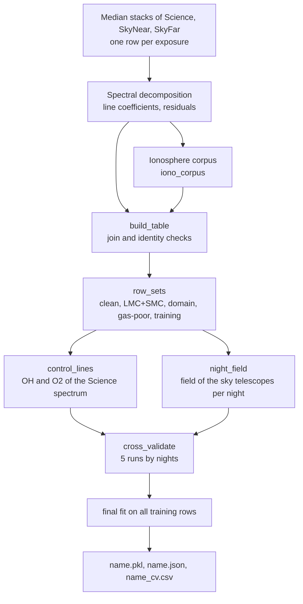

# Science [O I] 6300 model

`OI6300Model` predicts the atmospheric [O I] 6300 nightglow that the LVM Science telescope sees, from the two sky
telescopes of the same exposure and of the same night. This document describes the current model: what it is, how
the data were selected, how it is built step by step, how accurate it is, and how to rebuild it when the data
change. The same text is kept in the repository (`skysub/mlp_predictor/OI6300_MODEL.md`) and in the Obsidian note
`OI 6300 Science Model`. The studies that led to the model are indexed in `skysub/EXPERIMENTS_CHANGELOG.md`
(`experiments_ionospheric_oi_model`, `experiments_external_data_v1`, `experiments_dither_repeat_limits_v1`).

Status (2026-11-27): trained and validated on the knox DRP 1.3.2 median stacks. SkyML does not read it yet.

| File (under `skysub/`) | Role |
|---|---|
| `mlp_predictor/oi6300.py` | the model class: inputs, fit, guard, predict, save/load |
| `mlp_predictor/sky_field.py` | night field of the sky telescopes: kernel fit and field inputs |
| `mlp_predictor/oi6300_build.py` | the build: table, row selection, validation, final fit, saved files |
| `mlp_predictor/iono_corpus.py` | the ionosphere corpus that the build reads (one row per exposure) |
| `sky_decomp/tests/test_oi6300.py` | 10 tests of the three modules on a synthetic corpus |
| `oi6300_models/<name>.json` | provenance and test-night accuracy of a saved model (tracked) |
| `oi6300_models/<name>_cv.csv` | test-night prediction of every training row (tracked) |
| `oi6300_models/<name>.pkl` | the trained model (not tracked, 6-100 MB; rebuilt by one command) |

## 1. The model in one formula

    log10 I_sci = log10 V_sci + a log10 z_near + (1 - a) log10 z_far + delta(x)

| Symbol | Meaning |
|---|---|
| `I_sci` | slant [O I] 6300 brightness of the Science telescope [R]. `I = K c`, `c` = decomposition coefficient `ATOM_Or`, `K` = 1.298 R per unit coefficient |
| `z_near`, `z_far` | zenith brightness of SkyNear and SkyFar, `K c / V` |
| `V` | van Rhijn factor of a thin layer at 285 km |
| `a` | one scalar fitted on the training rows. The fit gives `a` = 1.00: SkyNear alone, rescaled to the Science line of sight. A telescope of zero weight is not read |
| `delta(x)` | learned correction: gradient boosting with absolute loss (scikit-learn `HistGradientBoostingRegressor`, 400 trees of at most 15 leaves, learning rate 0.03; `oi6300.HGB`), averaged over an ensemble of 5 models, each trained without one random group of nights |

The first three terms are the measurement of SkyNear moved to the Science direction by geometry alone. This alone
has a scatter of 0.0123 dex on the training rows. `delta(x)` learns what geometry does not explain.

## 2. How the model is built

One command runs every step below (`python -m mlp_predictor.oi6300_build`, section 5). Each step is one function
of `oi6300_build`, so a notebook can call them one by one and change any of them.



### Step 0. Input files

All of one median stack `STEM` in one directory `ROOT` (knox DRP 1.3.2:
`lvmsframe_median_stack_1.3.2_knox_gaia1over100`, 18,664 exposures):

| File | Content used |
|---|---|
| `STEM.fits` | `WAVE`, `FLUX_SCI`, `FLUX_SKY_NEAR`, `FLUX_SKY_FAR` (median spectrum of the Gaia-clean fibres of each telescope), `META` |
| `STEM_meta_only.fits` | `META`: exposure number, pointings of the telescopes, number of fibres in each median |
| `STEM_{sci,sky1,sky2}_meta_coef<suffix>.fits` | `COEF`: decomposition coefficients of each telescope (`ATOM_Or` = [O I] 6300, OH groups, O2, ...) |
| `STEM_decomp_{sci,sky1,sky2}<suffix>.fits` | `RESID`, `BESTFIT`: residual and model spectra of the decomposition |
| `iono_corpus_STEM.npz` | ionosphere corpus: 18,640 exposures, 869 nights (MJD 60176-61295), line coefficients, ionosphere and thermosphere at the pierce points, geometry |

Spectra are read on the native wavelength grid. Only pixel windows are cut out of it (6200-6400 A for the
equivalent width, 6560.3-6565.3 A for Halpha); nothing is resampled or smoothed.

### Step 1. One table per exposure (`build_table`)

The table has one row per corpus exposure and joins: the corpus columns, the 39 SkyML observing-context columns of
each telescope (matched by observation time), the separations of the three fields, and the quantities used only by
the selection (fibre counts, equivalent width, Halpha, Galactic latitude, LMC/SMC membership).

The build stops with an error if the files do not belong together:

- an exposure number is repeated in the stack or in the corpus;
- the stack and its `meta_only` file list different exposures;
- a coefficient file does not hold one row per exposure of the stack;
- a line coefficient of the corpus (6300, 7774, 8446, 5199, 5577; each telescope) differs from the coefficient file:
  the corpus is stale and must be rebuilt;
- a decomposition file is not the fit of its coefficient file (`ATOM_Or` differs), or its rows or grid are not
  those of the stack. The decomposition files carry no exposure number, so the test is that residual + best fit
  gives back the stack flux in the Halpha window of every row.

4 of the 18,640 corpus rows have no observing context (no decomposition row); their context is missing.

### Step 2. Row selection (`row_sets`)

The target is the [O I] 6300 that the decomposition measured on the Science spectrum. It is a clean measure of the
atmosphere only where the Science field itself emits no [O I] at the atmospheric wavelength. The selection keeps
exposures with a reliable measurement in all three telescopes, and trains only where the target is atmospheric.

| Step | Rule | Rows left | Nights |
|---|---|---:|---:|
| corpus | every exposure of the stack with an ionosphere row | 18,640 | 869 |
| enough fibres | in each telescope the median holds at least 10 fibres (few-fibre medians in crowded fields are dominated by stellar continuum and their weak lines fail) | 14,713 | 817 |
| line well measured | in each telescope log10 EW([O I] 6300) > 1.2 [A]; EW = line flux / median continuum in 6200-6285 and 6315-6400 A | 11,087 | 787 |
| all lines valid | in each telescope [O I] 6300, O I 7774, O I 8446 and [N I] 5199 between 0.1 and 10^4 R at zenith (outside it the fit drove the line to zero) | 10,432 | 778 |
| valid coordinates | no telescope pointing at ra = dec = 0 (broken coordinates; 32 corpus rows) | **10,426** | 777 |

These 10,426 rows are the **clean** set. It is then split by the Science field:

| Set | Rule | Rows | Nights | Use |
|---|---|---:|---:|---|
| LMC+SMC | clean, Science field inside the LMC (693) or SMC (428) regions. Their own [O I] is redshifted off the atmospheric line, so the target is atmospheric | 1,121 | 155 | training, test |
| domain | clean, Science field elsewhere | 9,305 | 735 | where the model will be applied; fixes which inputs are kept |
| gas-poor | domain, Halpha(Science) - Halpha(SkyNear) < 2 R, and abs(b) > 10 deg. Halpha is summed over 6560.3-6565.3 A of the decomposition residuals (the decomposition has no Halpha template); SkyNear removes the geocoronal part. 5,806 domain rows pass the Halpha cut, 3,713 also the latitude cut | 3,713 | 615 | training, test |
| **training** | LMC+SMC and gas-poor | **4,834** | 687 | fit and cross-validation |

On the training rows the target spans 23-930 R (1st-99th percentile, median 178 R) and the Science-SkyNear
separation 0-21 deg (median 3.6 deg).

The domain rows outside the gas-poor set are not used for training or for scores: their Science spectrum can hold
nebular [O I], so the target there is not the atmosphere alone.

### Step 3. Inputs of the correction (`oi6300.inputs`)

220 candidate inputs (225 with the night field), all measured without the Science
spectrum:

| Group | Content |
|---|---|
| sky lines | SkyNear and SkyFar log zenith 6300, 7774, 8446, 5199, and SkyFar - SkyNear of each |
| observing context | the 39 SkyML context columns of each of the three telescopes (Moon, Sun, ecliptic and Galactic geometry, time, zodiacal light) |
| ionosphere, thermosphere | 18 quantities at the 285 km pierce point of each telescope (`oi6300.IONO`: model 6300 and 7774, emission height, winds, VTEC and its gradients and rate, hmF2, NmF2, bottomside thickness, O, O2, temperature, dip latitude, bubble probability, ROTI); F10.7, its 81-day mean, Kp, Sun altitude at the conjugate point |
| geometry | separations of the three fields; differences between telescopes of log VTEC, dip latitude, pierce-point latitude and longitude, local time, airmass |

Rules applied to the inputs:

- **Coverage cut.** An input is kept only if at least 90% of the domain rows lie inside its 1-99% range on the
  training rows. This drops inputs on which the training fields do not represent the application fields
  (2 of 225: `sci ctx sci_sep`, `sci ctx ew` on knox 1.3.2). Outside the range trees return their edge value, so a prediction stays
  bounded; `predict` returns the number of inputs outside the range as a quality flag.
- **Missing values stay missing.** The trees route a missing input. A missing ROTI (no GNSS ray near the pierce
  point; about 8% of the rows) is not replaced by a quiet value; a measured ROTI is floored at 0.005 TECU/min
  before the logarithm.
- **No valid sky line, no prediction.** The prediction is NaN when the sky-telescope [O I] 6300 of the base is not
  valid.

### Step 4. Lines of the Science spectrum and the guard (`control_lines`, `sci_lines`)

The default model also reads airglow lines of the Science spectrum other than [O I] 6300. The Science [O I] 6300 is
never an input.

| Line | Kind | Input | Why |
|---|---|---|---|
| OH (median of 40 groups), O2 b(0-1) | control | Science/SkyNear zenith log ratio (van Rhijn at 95 km) | mesospheric; a nebula does not emit them. They carry a brightness factor common to all lines that differs between the two telescopes |
| [O I] 5577 | guarded | Science/SkyNear zenith log ratio (95 km) | airglow line that a nebula can also emit |
| O I 7774, O I 8446 | guarded | Science log zenith brightness and Science/SkyNear log ratio (285 km) | F-region lines that a nebula can also emit |
| [N I] 5199 | guarded, optional variant | as 7774 | the line most often nebular |

The 40 OH groups are those with the largest median SkyNear coefficient on the training rows; their list is stored
on the model (`oh_groups`).

**Guard.** A nebula in the Science field would add to a guarded line and bias the prediction. For each guarded
line a second model (the level model) predicts its Science/SkyNear ratio from the sky telescopes and the control
lines. `line_levels` gives the excess of the observed ratio over that prediction in units of its test-night
scatter (5577 0.0034 dex, 7774 0.0124 dex, 8446 0.0114 dex, 5199 0.0120 dex). A line above 3 sigma, or a line that is missing, is not used for that exposure: the
prediction comes from a model trained without it. One model is stored for every subset of the guarded lines
(8 subsets, 16 with 5199). `lines_used` reports which lines were used. The guard is one-sided (excess only).

### Step 5. Night field of the sky telescopes (`night_field`, `sky_field.py`)

Every exposure of a night gives two samples of the emitting layer, at the 285 km pierce points of SkyNear and
SkyFar. A Gaussian process is fitted to all samples of the night and read at the Science and SkyNear pierce points
of each exposure. Nothing measured on the Science spectrum enters.

| Input | Meaning |
|---|---|
| `field_sci_near_earth`, `field_sci_near_corot` | field at Science minus field at SkyNear [dex], in a frame fixed to the Earth and in a frame fixed in local time |
| `field_grad_earth`, `field_grad_corot` | field gradient at SkyNear times the Science-SkyNear offset [dex] |
| `field_n_1h` | number of sky-telescope samples within 1 h of the exposure that the field rests on |

- **Samples.** An exposure gives samples if its SkyNear and SkyFar medians hold at least 10 fibres and no pointing
  is at ra = dec = 0 (16,694 of 18,640 exposures). Samples beyond 4 robust sigma of the field are dropped.
- **Kernel parameters** are learned when a model is built (`sky_field.fit`): the maximum-likelihood values for the
  sky-telescope samples of 80 random nights with at least 8 usable exposures, the same for every night. Nothing is
  fitted on a single night. They are stored on the model (`field_hyper`) with the fit record: 80 nights, 3,698 samples; Earth-fixed frame converged: True, local-time frame converged: True.
- **Reading the parameters.** Knox 1.3.2, Earth-fixed frame: horizontal structure of 0.29 dex over 864 km that lasts 3.2 h, exposure term 0.065 dex, noise 0.018 dex. The likelihood constrains some terms
  weakly, and they move between fits on different nights (the duration of the structure was 1.0 h in the fit before
  the review); the model accuracy does not depend on it. Read them as a fitted kernel, not as physics.
- A night with fewer than 3 usable samples has no field (406 of 18,640 corpus rows); the inputs are then missing.
- The field of an exposure uses the later exposures of its night: **post-processing only**.

### Step 6. Validation by nights (`cross_validate`)

The corpus nights are split at random into 5 groups (fixed seed). Each group is predicted by a model that was
built without it, in 5 runs:

| Run | Training rows (nights) | Test rows (nights) |
|---|---:|---:|
| 1 | 3,751 (551) | 1,083 (136) |
| 2 | 4,007 (555) | 827 (132) |
| 3 | 3,760 (542) | 1,074 (145) |
| 4 | 3,984 (557) | 850 (130) |
| 5 | 3,834 (543) | 1,000 (144) |

Everything that is learned is learned again inside each run, from the other nights only:

- the scalar `a`, the ensemble of 5, the models of every subset of guarded lines, the level models and their
  scatter;
- the choice of the 40 OH groups;
- the kernel parameters of the night field (the field of a test night is then computed from the sky telescopes of
  that night with these parameters, which is how the model is applied);
- the input ranges and the coverage cut (training rows and domain rows of the other nights).

So no row is scored by anything that saw its night. The test-night prediction of every training row is saved in
`<name>_cv.csv`.

### Step 7. Final fit and saved files

After the validation the model is fitted once more on all 4,834 training rows (OH groups, kernel parameters and
input ranges from all nights). The test-night scores are its expected accuracy.

- `<name>.pkl`: the model, with `oh_groups`, `field_hyper` and `meta`.
- `<name>.json` (= `meta`): the options, the input files with size and checksum (size and time for the multi-GB
  spectral files), the git commit and the checksums of the three modules, the settings (K, boosting settings,
  selection thresholds), the row counts, the OH groups, the kernel parameters and their fit record, the inputs
  dropped by the coverage cut, the level scatters, the test-night scores and the package versions.
- `<name>_cv.csv`: exposure, night, run, observed and test-night predicted log10 brightness, and whether a guarded
  line was not used.

A model records the version of its inputs (`inputs_version`). `OI6300Model.load` refuses a model built for another
version, so a change of the input definitions cannot be applied silently to an old model.

## 3. Accuracy

Scatter (1.4826 MAD) of log10 I_observed - log10 I_predicted on test nights, in dex; percent of flux is
10^sigma - 1.

| Model | Inputs | sigma [dex] | sigma [% of flux] | 95% interval of sigma [dex] | RMS [dex] | before the review [dex] |
|---|---|---:|---:|---:|---:|---:|
| **default**: Science lines + night field | sky telescopes, observing context, ionosphere, geometry; Science lines OH, O2, 5577, 7774, 8446; night field | 0.0055 | 1.3 | 0.0051-0.0059 | 0.0155 | 0.0056 |
| default + [N I] 5199 | the default plus Science [N I] 5199 | 0.0051 | 1.2 | 0.0048-0.0054 | 0.0145 | 0.0051 |
| Science lines, no field | as the default, without the night field | 0.0062 | 1.4 | 0.0058-0.0066 | 0.0163 | 0.0062 |
| Science lines + 5199, no field | the default plus Science [N I] 5199, without the night field | 0.0056 | 1.3 | 0.0053-0.0060 | 0.0149 | 0.0056 |
| no Science lines, night field | no Science-spectrum input; with the night field | 0.0071 | 1.6 | 0.0066-0.0076 | 0.0166 | 0.0073 |
| no Science lines, no field | no Science-spectrum input, no night field | 0.0083 | 1.9 | 0.0078-0.0089 | 0.0176 | 0.0083 |
| SkyNear rescaled, no correction | SkyNear [O I] 6300 and the van Rhijn factors | 0.0123 | 2.9 | | | |

- **Reference for the measurement itself.** Repeat observations of the same LMC/SMC tiles give a scatter of the
  Science/SkyNear [O I] 6300 ratio of about 0.003 dex (`experiments_dither_repeat_limits_v1`). It is an empirical
  repeatability of this ratio, with contributions of both telescopes; the model cannot be expected to do better.
- **Uncertainty of the scatter.** The 95% interval comes from 1,000 resamplings of the test nights with the predictions fixed; it does not include the uncertainty of the model choice.
- **Tails.** The robust scatter describes the core. Default model: 90%, 95% and 99% of the rows are within 0.016, 0.025 and 0.062 dex; 1.7% are beyond 0.05 dex. The RMS (0.0155 dex) is set by these tails.

By rows and by Science-SkyNear separation (sigma, dex):

| Rows (count) | **default**: Science lines + night field | default + [N I] 5199 | Science lines, no field | Science lines + 5199, no field | no Science lines, night field | no Science lines, no field |
|---|---:|---:|---:|---:|---:|---:|
| all (4,834) | 0.0055 | 0.0051 | 0.0062 | 0.0056 | 0.0071 | 0.0083 |
| LMC+SMC (1,121) | 0.0056 | 0.0056 | 0.0064 | 0.0058 | 0.0069 | 0.0074 |
| gas-poor (3,713) | 0.0054 | 0.0050 | 0.0062 | 0.0055 | 0.0071 | 0.0085 |
| separation 0-2 deg (1,127) | 0.0026 | 0.0027 | 0.0030 | 0.0031 | 0.0042 | 0.0045 |
| separation 2-4 deg (1,500) | 0.0048 | 0.0046 | 0.0056 | 0.0050 | 0.0063 | 0.0071 |
| separation 4-6 deg (1,334) | 0.0074 | 0.0069 | 0.0089 | 0.0075 | 0.0088 | 0.0106 |
| separation 6-10 deg (628) | 0.0096 | 0.0077 | 0.0113 | 0.0094 | 0.0101 | 0.0138 |
| separation 10-90 deg (245) | 0.0246 | 0.0162 | 0.0242 | 0.0170 | 0.0284 | 0.0268 |

- The error grows with the separation; below 2 deg the default model is at the repeatability of the measurement.
- Rows with at least one guarded line not used: 10.3% (default: Science lines + night field); 12.8% (default + [N I] 5199); 10.3% (Science lines, no field); 12.8% (Science lines + 5199, no field).

**Emission in the Science lines.**

- One line at a time, 1 dex added: the unguarded model is biased by up to 0.010 dex and the guarded one is not;
  just below the threshold up to 0.004 dex of bias remains for 5199 and 0.001-0.002 dex for the other lines
  (`experiments_external_data_v1/science_lines/REPORT.md`, on the earlier row set).
- The same excess added to all three guarded lines at once (default model as saved, training rows; shift of the
  prediction relative to the unchanged input):

  | Added to each line [dex] | Median shift [dex] | 95% of rows within [dex] | Rows with all three dropped |
  |---:|---:|---:|---:|
  | 0.01 | +0.0049 | 0.0091 | 2% |
  | 0.03 | +0.0023 | 0.0083 | 13% |
  | 0.1 | +0.0001 | 0.0070 | 97% |
  | 1 | +0.0001 | 0.0070 | 100% |

  An excess of 0.1 dex or more is caught: the lines are dropped and the prediction moves by less than 0.001 dex in
  the median. A weak excess common to the guarded lines (0.01-0.03 dex) is below the guard and is read partly as
  the telescope factor: the prediction rises by up to half of it. This is a limit of the current guard, not removed
  by this version.

## 4. What changed in the review of 2026-11-27

The model was reviewed twice before the first commit, the second time against an independent review
(Obsidian note `OI 6300 Uncommitted Review 2026-11-27`). Changes of the second pass, all followed by a rebuild:

| Finding | Change |
|---|---|
| exposures with broken coordinates gave samples to the night field | such exposures give no sample |
| a missing ROTI was read as a quiet ionosphere | it stays missing |
| a SkyFar line of zero weight could make the prediction NaN | a telescope of zero weight is not read |
| the validation learned the OH groups, the kernel parameters and the input ranges from all nights | all three are learned inside each run from the other nights |
| the kernel fit accepted nights without usable samples and did not report convergence | nights are chosen by usable exposures; the fit record is stored; a failed fit is an error |
| only [O I] 6300 was compared between corpus and decomposition; residual files were accepted by shape | every line is compared; rows and grid are checked through the flux |
| the saved record did not identify inputs, code and settings | it does (step 7); old models are refused on load |
| repeated lines or a non-positive ensemble size failed late | rejected before the fit |
| the share of rows with a dropped line ignored missing lines | counted through `lines_used` |

Effect on the scores (last column of the first table of section 3): no model got worse under the stricter
validation. The models with the night field improved slightly (0.0056 to 0.0055 and 0.0073 to 0.0071 dex).

## 5. Rebuild

Run from `skysub/` with the project environment (`lvmsky/.venv`; needs scikit-learn, extra `oi6300`). The model is
used from a checkout of the repository; the wheel of the package does not include `mlp_predictor`.

When the data change (new DRP version, new stack, new decomposition):

1. Decompose the median stack (`python -m skysub.decompose_parallel`), which writes the `_meta_coef` and `_decomp`
   files next to it.
2. Build the ionosphere corpus of that stack (`python -m mlp_predictor.iono_corpus --decomp-root ROOT --stem STEM`;
   see `sky_decomp/data/ionosphere/corpus/README.md`).
3. Build the model:

```bash
python -m mlp_predictor.oi6300_build --decomp-root ROOT --stem STEM --out oi6300_models --sci-lines oh o2 5577 7774 8446 --sky-field
```

4. Read `<name>.json`: the row counts of step 2, the test-night scores, and `field_hyper.fit` (converged or not).

| Option | Effect |
|---|---|
| `--sci-lines ...` | Science lines to read; append `5199` for the optional variant; omit for a model without Science lines |
| `--sky-field` | learn the kernel parameters and add the night field; the file name gets `_field` |
| `--members N` | ensemble size (default 5; 1 = a single model) |
| `--guard S` | guard threshold in sigma (default 3) |
| `--no-cv` | skip the validation (no scores) |
| `--corpus FILE`, `--name NAME` | another corpus file; another output name |

Time on 18 cores with 3 threads per build, several builds at once: about 1 minute without Science lines and field, 12 minutes with the field alone (six kernel fits), 9-14 minutes with Science lines, 22-27 minutes with Science lines and the field.

To change a step, call the functions of `oi6300_build` from a notebook: `build_table`, `row_sets`,
`control_lines`, `night_field`, `cross_validate`, `scores`. Thresholds are the constants at the top of each module.
When the meaning of an input changes, raise `oi6300.INPUTS_VERSION` and rebuild.

## 6. Use

```python
from mlp_predictor import oi6300, oi6300_build

m = oi6300.OI6300Model.load('oi6300_models/oi6300_model_oh_o2_5577_7774_8446_field_ens5.pkl')
tab, aux = oi6300_build.build_table(dcfg, corpus)                         # exposures of a decomposed stack
oi6300_build.control_lines(dcfg, tab, aux, None, oh_groups=m.oh_groups)   # the OH groups of this model
oi6300_build.night_field(tab, aux, m.field_hyper)                         # tab must hold whole nights
log_i, flag = m.predict(tab)    # log10 slant Science [O I] 6300 [R]; number of inputs outside the training range
c = m.coefficient(tab)          # predicted Science ATOM_Or
used = m.lines_used(tab)        # (n_rows, n_guarded): guarded lines used for each exposure
levels = m.line_levels(tab)     # excess of each guarded line [sigma]
q = m.quality(tab)              # counts of inputs out of range and missing
m.meta                          # what the model was trained on, and its scores
```

On the knox 1.3.2 corpus the default model gives a prediction for 18,576 of 18,640 exposures; the others
have no valid SkyNear [O I] 6300.

## 7. Limits

- **Post-processing only.** The default model needs every exposure of the night (night field).
- **Where it is validated.** Clean rows of LMC+SMC and gas-poor fields. In fields with gas the target itself holds
  nebular [O I], so the accuracy there cannot be measured this way.
- **The clean cut reads the Science spectrum** (its fibre count, the EW and validity of its lines, its Halpha), so
  the scores describe exposures with a well-measured Science [O I] 6300, not every exposure.
- **Rows outside the clean set.** A guarded Science line can be missing there (6% of the corpus rows for 7774 and
  8446, none of the clean rows); the model trained without it is used. The accuracy on such rows is not measured.
- **Guard.** Weak emission common to the guarded lines is not caught (section 3). The 3 sigma threshold is a first
  choice, not tuned. Injection tests change coefficients; they do not test the decomposition of a real nebular
  spectrum.
- **Night without a field** (fewer than 3 usable samples): the field inputs are missing and the model falls back on
  its other inputs; this case is not scored separately.
- **Model selection.** The inputs, the Science lines and the field were chosen with these same nights; that adds
  an optimism the scores do not include.
- **File format.** The model is a pickle of scikit-learn objects and of this code: load it with the package
  versions and the checkout recorded in `meta`.
- **ROTI cache.** `roti.py` keeps navigation files and reduced station days that were downloaded before its
  incomplete-file fix; on this machine they were refetched by hand. A fresh machine is not affected.
- Not checked on single-fibre spectra; not wired into SkyML.
